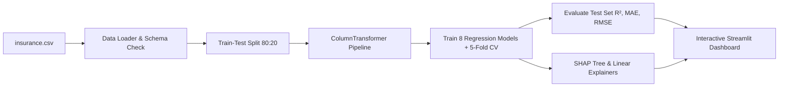

# Explainable Machine Learning for Medical Health Insurance Cost Prediction

[](https://www.python.org/)
[](https://scikit-learn.org/)
[](https://xgboost.readthedocs.io/)
[](https://shap.readthedocs.io/)
[](https://streamlit.io/)
[](https://docs.pytest.org/)

An academic and production-grade Machine Learning system designed to predict medical insurance charges from applicant health and demographic profiles, accompanied by comprehensive Exploratory Data Analysis, 8-model competitive benchmarking, and Explainable AI (SHAP) feature attributions.

---

## 📌 1. Project Overview & Objectives

Predicting healthcare insurance costs is a classic regression problem. Traditional actuarial and machine learning models often behave as "black boxes," leaving applicants and researchers wondering *why* a specific premium was estimated.

This project delivers:
1. **Accurate Cost Estimation:** Regression models predict annual healthcare costs ($) using attributes like age, sex, BMI, number of dependents, smoking habits, and geographic region.
2. **Fair 8-Model Benchmarking:** Implements and ranks 8 distinct regressors (Linear Regression, Ridge, Lasso, Random Forest, Gradient Boosting, XGBoost, LightGBM, and CatBoost) evaluated via 5-Fold Cross-Validation and an independent hold-out test set.
3. **Explainable AI (XAI):** Employs **SHAP (Shapley Additive Explanations)** based on cooperative game theory to unpack global population drivers and provide local waterfall plots for individual applicant predictions.
4. **Leak-Free Data Pipeline:** Utilizes Scikit-Learn `ColumnTransformer` and `Pipeline` fitted strictly on training data splits, completely preventing data and target leakage.
5. **Interactive Web Application:** A Streamlit dashboard supporting live EDA, 1-click model retraining, interactive cost prediction, and plain-English feature contribution explanations.

> **⚠️ Academic & Educational Disclaimer:**
> Predictions generated by this system are statistical approximations for research and educational purposes. They do not constitute official insurance quotations, underwriting guarantees, or clinical advice.

---

## 🏗️ 2. Project Architecture & Directory Layout

```text
health insurence/
├── data/
│   ├── .gitkeep
│   └── insurance.csv              # Benchmark dataset (1,338 records)
├── models/
│   ├── .gitkeep
│   ├── best_model.joblib          # Serialized champion model
│   └── preprocessor.joblib        # Fitted ColumnTransformer pipeline
├── src/
│   ├── __init__.py
│   ├── data_loader.py             # Schema validation, missing checks, dataset loading
│   ├── preprocessing.py          # ColumnTransformer, train/test split, leakage prevention
│   ├── train.py                  # 8 ML regressors, 5-Fold CV, joblib persistence
│   ├── evaluate.py               # MAE, RMSE, R², safe MAPE, diagnostic plots
│   ├── explain.py                # SHAP global & local waterfall explainers
│   └── predict.py                # Input bounds validation & inference engine
├── tests/
│   ├── __init__.py
│   ├── test_preprocessing.py     # Loader & pipeline unit tests
│   └── test_prediction.py        # Prediction & metric calculation tests
├── app.py                         # Multi-page Streamlit web application
├── requirements.txt               # Pinned Python package dependencies
├── .gitignore                     # Git ignore rules for virtualenvs, caches & artifacts
└── README.md                      # Complete project documentation & guide
```

---

## 🔄 3. Complete End-to-End Workflow



- **Step 1 — Dataset Ingestion:** Loads `insurance.csv` and verifies presence of all 7 expected columns (`age`, `sex`, `bmi`, `children`, `smoker`, `region`, `charges`).
- **Step 2 — Data Cleaning & EDA:** Evaluates missing values, duplicates, and verifies target skewness.
- **Step 3 — Leak-Free Preprocessing:** Standardizes numerical columns (`StandardScaler`) and encodes categorical features (`OneHotEncoder(drop='first')`) strictly fitted on `X_train`.
- **Step 4 — Model Training:** Fits 8 regression algorithms across linear and tree-boosting families.
- **Step 5 — Evaluation & Comparison:** Ranks models by test $R^2$, Mean Absolute Error (MAE), and Root Mean Squared Error (RMSE).
- **Step 6 — Explainable AI:** Calculates SHAP values to explain both global feature importance and individual prediction breakdowns.
- **Step 7 — Deployment:** Exposes the complete workflow via a responsive Streamlit interface.

---

## 🤖 4. Theoretical Explanation of the 8 Regression Models

| # | Model | Core Principle & Mathematical Logic | Key Strength |
|---|---|---|---|
| **1** | **Linear Regression** | Models charges as a weighted linear combination of input features: $\hat{y} = w^T x + b$. Solves Ordinary Least Squares (OLS). | Highly interpretable baseline. |
| **2** | **Ridge Regression (L2)** | Minimizes OLS loss plus an $L_2$ penalty on weights: $\lambda \sum w_i^2$. | Prevents multicollinearity and stabilizes feature coefficients. |
| **3** | **Lasso Regression (L1)** | Minimizes OLS loss plus an $L_1$ penalty on weights: $\lambda \sum \|w_i\|$. | Drives non-essential coefficients to exact zero, performing automatic feature selection. |
| **4** | **Random Forest** | An ensemble of 150 decorrelated decision trees built on bootstrapped subsets with random feature splits. | Drastically reduces model variance and handles non-linear interactions. |
| **5** | **Gradient Boosting** | Sequentially constructs shallow decision trees, where each new tree fits the residual errors (pseudo-residuals) of prior trees. | High predictive accuracy by correcting errors stage-by-stage. |
| **6** | **XGBoost Regressor** | Extreme Gradient Boosting using second-order Taylor expansion of the loss function, column subsampling, and cache awareness. | State-of-the-art tabular accuracy and regularization against overfitting. |
| **7** | **LightGBM Regressor** | Leaf-wise (best-first) tree growth strategy with histogram-based binning of continuous features. | Extremely fast training with exceptional memory efficiency. |
| **8** | **CatBoost Regressor** | Implements Ordered Boosting and symmetric (oblivious) trees to eliminate target leakage and overfitting on categorical splits. | Superior out-of-the-box performance on datasets with categorical columns. |

---

## 💻 5. Setup & Execution on Windows (PowerShell)

### Prerequisites
- Python 3.10+ installed on your system.
- PowerShell or Windows Command Prompt.

### Step 1: Open PowerShell in Project Directory
Navigate to the project folder:
```powershell
cd "c:\Users\HP\OneDrive\Desktop\health insurence"
```

### Step 2: Create and Activate Virtual Environment
```powershell
python -m venv .venv
.\.venv\Scripts\Activate.ps1
```
*(If PowerShell shows an execution policy restriction, run `Set-ExecutionPolicy -Scope Process -ExecutionPolicy Bypass` first).*

### Step 3: Upgrade pip and Install Dependencies
```powershell
python -m pip install --upgrade pip
pip install -r requirements.txt
```

### Step 4: Verify Dataset Placement
The benchmark dataset is pre-installed at `data/insurance.csv`. If downloading manually from Kaggle, place it in the `data/` directory:
```powershell
Test-Path "data/insurance.csv"   # Should return True
```

### Step 5: Run Automated Unit Tests
Verify all data loading, preprocessing, and prediction assertions pass:
```powershell
python -m pytest tests/ -v
```

### Step 6: Launch the Streamlit Web Application
```powershell
streamlit run app.py
```
Your default browser will automatically open:
```text
Local URL: http://localhost:8501
```

---

## 🧪 6. Testing Each Feature in the Web App

1. **Overview & Dataset Tab:**
   - Review the 4 high-level KPI cards (Total Records, Feature Count, Mean Cost, Best Model).
   - Inspect the first 10 rows and check data types.
2. **Exploratory Data Analysis Tab:**
   - **Distributions:** Observe the right-skewed charges distribution with mean ($13,270) vs. median ($9,382).
   - **Group Comparisons:** Observe the huge cost discrepancy between smokers and non-smokers.
   - **Correlations:** Inspect the Pearson correlation matrix.
3. **Model Training & Comparison Tab:**
   - Examine the 8-model competitive leaderboard.
   - Inspect side-by-side bar plots comparing test MAE and RMSE.
   - Select any model from the dropdown to view its **Predicted vs. Actual** and **Residual Distribution** plots.
4. **Cost Prediction & SHAP Explainability Tab:**
   - Use the sliders and dropdowns to enter custom applicant values (e.g., Age: 35, Sex: Male, BMI: 28.5, Children: 2, Smoker: No, Region: Southwest).
   - Click **"🚀 Predict & Explain Charges"**.
   - Review the estimated cost card and its comparison to the population average.
   - Inspect the **SHAP Waterfall Plot** to see which features added or subtracted dollars from the base value.
   - Read the **Plain-English Explanation** translating Shapley values into conversational English.

---

## 🎓 7. College Teacher / Viva Presentation Guide

### 30-Second Elevator Pitch:
> *"Respected Professor, my project is **Explainable Machine Learning for Medical Health Insurance Cost Prediction**. Rather than presenting a simple prediction script, I built an end-to-end academic system that trains and benchmarks 8 distinct regression algorithms. Crucially, because machine learning models in healthcare must be trustworthy, I integrated **SHAP (Shapley Additive Explanations)** to explain both global dataset patterns and individual local predictions. The entire system is deployed as an interactive Streamlit web application with automated unit testing."*

### Key Viva Questions & Answers:

**Q1: Why did you use `ColumnTransformer` instead of manual `pd.get_dummies()`?**
> *Answer:* `pd.get_dummies()` on the entire dataset causes **data leakage**, because the test set information leaks into the encoding schema. Using Scikit-Learn's `ColumnTransformer` inside a pipeline allows us to fit strictly on the training set and transform the test set with identical mappings.

**Q2: What is the most important feature driving insurance costs?**
> *Answer:* As demonstrated by our EDA and SHAP beeswarm plots, **smoking status (`smoker`)** is by far the single largest cost driver, followed by **`age`** and **`bmi`**. Furthermore, our scatter plot reveals a compound interaction: individuals who smoke AND have a BMI > 30 experience an exponential surge in charges.

**Q3: What are SHAP values and why are they better than standard feature importance?**
> *Answer:* Standard tree feature importance (like Gini or split frequency) only tells us if a feature was used frequently, but doesn't tell us the *direction* (whether it increases or decreases the price) and can be biased toward continuous features. SHAP is derived from cooperative game theory (Lloyd Shapley, Nobel Prize). It guarantees additive efficiency: the sum of feature contributions plus base value exactly equals the predicted output.

**Q4: Which regression metrics did you choose and why?**
> *Answer:* We evaluated **MAE** (Mean Absolute Error) for intuitive dollar-denominated average error, **RMSE** (Root Mean Squared Error) to penalize large outlier errors, and **$R^2$** to measure the proportion of variance explained by the model.

---

## 📚 8. References & Citations

A complete, categorized bibliography of **50 peer-reviewed papers** (from IEEE Xplore, ScienceDirect/Elsevier, Springer Nature, and PubMed Central) is compiled in [REFERENCES.md](file:///c:/Users/HP/OneDrive/Desktop/health%20insurence/REFERENCES.md).

### Key Citations:
1. **Dataset Benchmark:** Lantz, B. (2013). *Machine Learning with R*. Packt Publishing. [Kaggle Dataset by Mir Choi](https://www.kaggle.com/datasets/mirichoi0218/insurance).
2. **Explainable Cost Prediction (2024):** *Machine Learning for an Explainable Cost Prediction of Medical Insurance*. ScienceDirect / Elsevier. [Paper Link](https://www.sciencedirect.com/science/article/pii/S2666827023000695).
3. **Health Insurance Premium Regression (2022):** *Machine Learning-Based Regression Framework to Predict Health Insurance Premiums*. PubMed Central. [Paper Link](https://pmc.ncbi.nlm.nih.gov/articles/PMC9265373/).
4. **SHAP (Shapley Additive Explanations):** Lundberg, S. M., & Lee, S. I. (2017). *A Unified Approach to Interpreting Model Predictions*. Advances in Neural Information Processing Systems (NeurIPS 2017).
5. **XGBoost:** Chen, T., & Guestrin, C. (2016). *XGBoost: A Scalable Tree Boosting System*. Proceedings of the 22nd ACM SIGKDD.
6. **Complete 50 References Guide:** See full literature review and DOIs in [REFERENCES.md](file:///c:/Users/HP/OneDrive/Desktop/health%20insurence/REFERENCES.md).

---

## 📄 License
This project is open-source under the MIT License for educational and academic research.
