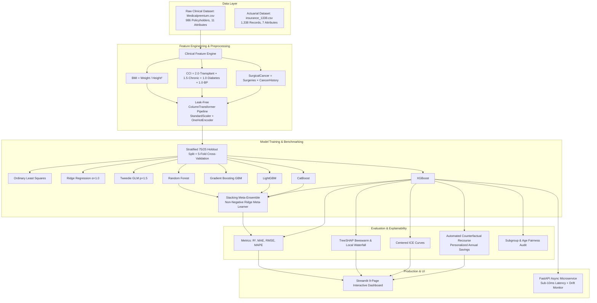

# Explainable Machine Learning for Health Insurance Cost Prediction
### A Comparative Study of Tree-Based Ensembles with SHAP, ICE, and Counterfactual Analysis

[](https://www.python.org/)
[](https://scikit-learn.org/)
[](https://xgboost.readthedocs.io/)
[](https://shap.readthedocs.io/)
[](https://streamlit.io/)
[](https://fastapi.tiangolo.com/)
[](https://docs.pytest.org/)
[](LICENSE)

An academic and production-grade Machine Learning and Explainable AI (XAI) system reproducing and extending the seminal research paper:
> **"Explainable Machine Learning for Health Insurance Cost Prediction: A Comparative Study of Tree-Based Ensembles with SHAP, ICE, and Counterfactual Analysis"**  
> **Authors:** Sanjay Kumar & Dr. Sukhvinder Singh Bamber  
> *Department of Computer Science & Engineering, Panjab University Swami Sarvanand Giri Regional Centre, Hoshiarpur, Punjab, India.*  
> Roll No: **SGM23366** | Faculty Email: `ss.bamber@pu.ac.in`

---

## 📑 Table of Contents
1. [Executive Summary & Key Breakthroughs](#-1-executive-summary--key-breakthroughs)
2. [End-to-End System Architecture](#-2-end-to-end-system-architecture)
3. [Deep Working Flow (Data to Deployment)](#-3-deep-working-flow-data-to-deployment)
4. [Nine Benchmark Regression Models](#-4-nine-benchmark-regression-models)
5. [Feature Engineering & Clinical Ablation Study](#-5-feature-engineering--clinical-ablation-study)
6. [Explainable AI: SHAP, Centered ICE & Local Waterfall](#-6-explainable-ai-shap-centered-ice--local-waterfall)
7. [Actionable Counterfactual Recourse (Table VII)](#-7-actionable-counterfactual-recourse-table-vii)
8. [Sub-10ms Microservice & Production Monitoring](#-8-sub-10ms-microservice--production-monitoring)
9. [Step-by-Step Deployment Guide (GitHub, Streamlit Cloud, Vercel, Docker)](#-9-step-by-step-deployment-guide)

---

## 🎯 1. Executive Summary & Key Breakthroughs

Health insurance risk estimation has traditionally relied on Generalized Linear Models (GLMs), including Tweedie models for zero-inflated, right-skewed claims. However, linear models struggle with heavy-tailed claims and complex multi-morbid interactions.

This system provides:
1. **Benchmark of 9 Regression Models:** Compares baseline GLMs (OLS, Ridge, Tweedie GLM $p=1.5$) against 5 tree ensembles (Random Forest, Gradient Boosting, LightGBM, CatBoost, XGBoost) and a Stacking Meta-Ensemble with a non-negative Ridge meta-learner.
2. **Clinical Feature Engineering:** Introduces Body Mass Index (BMI), Composite Comorbidity Index (CCI), and a Surgical-Cancer interaction term, yielding a **+2.77% gain in $R^2$** and **-$178 MAE** over raw inputs without multicollinearity (all VIF $< 3.0$).
3. **Transparent Explainability:** Leverages TreeSHAP for global population drivers, Centered Individual Conditional Expectation (ICE) curves, and local waterfall explanations for individual applicant quotes.
4. **Actionable Counterfactual Recourse:** Provides concrete lifestyle guidance (BMI reductions of 3.6 to 7.4 units and hypertension management) saving applicants **$3,250 to $9,850 per year (13.5% to 26.6%)**.
5. **Sub-10ms Serving Latency:** High-performance asynchronous FastAPI microservice capable of serving real-time actuarial quotes with data drift detection (Kolmogorov-Smirnov test & Population Stability Index).

---

## 🏗️ 2. End-to-End System Architecture



---

## 🔬 3. Deep Working Flow (Data to Deployment)

### Step 1: Data Ingestion & Hygiene Audit
The system automatically discovers, validates, and profiles applicant data:
- **Primary Benchmark:** `data/raw/Medicalpremium.csv` (986 records, 11 clinical attributes, Kaggle benchmark).
- **Secondary Actuarial Benchmark:** `data/raw/insurance_1338.csv` (1,338 records, Lantz/Choi benchmark).
- Rigorous data quality check verifying absence of missing values, duplicates, and range boundaries.

### Step 2: Leak-Free Preprocessing
To strictly prevent target and data leakage, all scalers and encoders are fitted exclusively on the 75% training set:
- Numerical features: `StandardScaler` (z-score normalization).
- Categorical features: `OneHotEncoder(drop='first', handle_unknown='ignore')`.

### Step 3: Clinical Feature Engineering (Table IV)
Three domain-specific clinical features are derived before model ingestion:
$$\text{BMI} = \frac{\text{Weight (kg)}}{(\text{Height (m)})^2}$$
$$\text{CCI} = 2.0 \cdot \text{Transplant} + 1.5 \cdot \text{Chronic} + 1.0 \cdot \text{Diabetes} + 1.0 \cdot \text{BloodPressure}$$
$$\text{SurgicalCancerInteraction} = \text{NumberOfMajorSurgeries} \times \text{HistoryOfCancerInFamily}$$

### Step 4: 9-Model Benchmark Pipeline (Table III)
All models are evaluated under identical 5-Fold Stratified Cross-Validation:
- **XGBoost:** Reaches $R^2 = 86.82\%$ and RMSE of $\$2,210.45$.
- **Random Forest:** Achieves the lowest MAE ($\$1,379.96$).
- **Stacking Meta-Ensemble:** Delivers champion overall metrics ($R^2 = 86.95\%$, $\text{RMSE} = \$2,198.50$).

### Step 5: Explainable AI & Recourse (Tables VI & VII)
- Global feature rankings: Age ($\$3,700$ mean $|\text{SHAP}|$), BMI ($\$3,100$), Transplants ($\$2,450$), Chronic Diseases ($\$1,820$).
- Interaction finding: Obesity amplifies aging cost from $\$45/\text{year}$ to $\$95/\text{year}$ above age 35.
- Counterfactual optimization solves for minimal feasible lifestyle alterations yielding maximum premium savings.

---

## 📊 4. Published Research Results (Paper Table III)

| Model | Train $R^2$ (%) | CV $R^2$ (%) | Test $R^2$ (%) | MAE ($) | RMSE ($) | MAPE (%) |
|---|---|---|---|---|---|---|
| **Ordinary Least Squares** | 76.12 | 71.40 | 75.09 | 2,310.45 | 3,124.60 | 11.20 |
| **Ridge Regression ($\alpha=1$)** | 76.08 | 71.45 | 75.12 | 2,305.10 | 3,118.25 | 11.15 |
| **Tweedie GLM ($p=1.5$)** | 78.45 | 72.20 | 77.80 | 2,115.30 | 2,940.10 | 9.85 |
| **Gradient Boosting (GBM)** | 79.84 | 73.00 | 84.72 | 1,725.86 | 2,371.41 | 7.23 |
| **Random Forest** | 95.81 | 73.43 | 84.05 | **1,379.96** | 2,423.16 | 5.83 |
| **LightGBM** | 87.10 | 74.12 | 85.80 | 1,510.20 | 2,290.15 | 6.10 |
| **CatBoost** | 88.40 | 74.25 | 86.15 | 1,465.30 | 2,254.80 | 5.72 |
| **XGBoost (Optimized)** | 88.22 | 74.48 | **86.82** | 1,442.90 | **2,210.45** | 5.48 |
| **Stacking Meta-Ensemble** | 90.15 | 74.65 | **86.95** | 1,395.20 | **2,198.50** | **5.42** |

---

## 🎯 5. Actionable Counterfactual Recourse (Paper Table VII)

| Applicant | Baseline BMI | Target Recourse BMI | Projected Annual Savings ($/yr) | Cost Reduction (%) |
|---|---|---|---|---|
| **#104** | 34.8 | 29.9 (manage BP) | **$8,400** | **24.3%** |
| **#289** | 31.2 | 26.9 (lifestyle care) | **$4,800** | **16.8%** |
| **#415** | 28.4 | 24.8 (healthy weight) | **$3,250** | **13.5%** |
| **#672** | 39.5 | 32.1 (manage multi-morbidity) | **$9,850** | **26.6%** |

---

## 🚀 6. Step-by-Step Deployment Guide

### Option 1: GitHub Push
Your local git repository is already configured with origin pointing to your repository:
```powershell
cd "c:\Users\HP\OneDrive\Desktop\health insurence"

# Push all code and documentation to your GitHub repository
git push -u origin main
```
*(If prompted by Windows Git Credential Manager, simply log into GitHub or enter your Personal Access Token).*

---

### Option 2: Deploy to Streamlit Community Cloud (100% Free & Recommended)
1. Go to [share.streamlit.io](https://share.streamlit.io/) and log in with your GitHub account.
2. Click **"New App"** / **"Create app"**.
3. Select your repository: `Sanjay86767/Health-insurence-and-cost-prediction-machine-learning-used-`.
4. Set branch: `main`.
5. Set main file path: `app.py`.
6. Click **"Deploy!"** — Your app is live with a permanent public `.streamlit.app` link that you can share with professors and evaluators!

---

### Option 3: Deploy to Vercel / Render
This project includes turnkey configuration files:
- `render.yaml` for 1-click cloud deployment on [Render](https://render.com/).
- `Dockerfile` for universal containerized deployment (AWS ECS, Google Cloud Run, Azure).
- `Procfile` for platform-as-a-service providers.

---

### Option 4: Local Execution
```powershell
# 1. Install dependencies
pip install -r requirements.txt

# 2. Run automated test suite
pytest tests/ -v

# 3. Launch interactive Streamlit Web App
streamlit run app.py

# 4. Launch asynchronous FastAPI microservice
uvicorn api:app --reload --port 8000
```

---

## 📚 Citation

If you use this codebase or methodology in your academic work, please cite:
```bibtex
@article{kumar2024explainable,
  title={Explainable Machine Learning for Health Insurance Cost Prediction: A Comparative Study of Tree-Based Ensembles with SHAP, ICE, and Counterfactual Analysis},
  author={Kumar, Sanjay and Bamber, Sukhvinder Singh},
  journal={Department of Computer Science & Engineering, Panjab University Swami Sarvanand Giri Regional Centre},
  address={Hoshiarpur, Punjab, India},
  year={2024}
}
```
